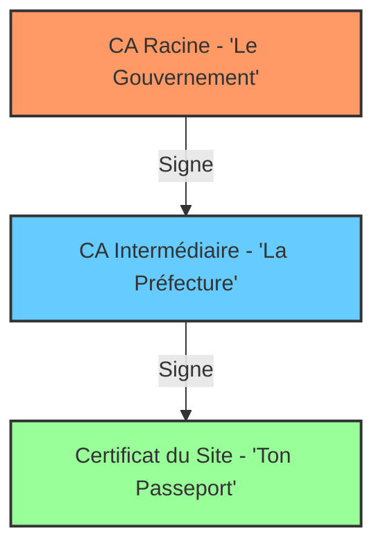

_Autorités de Certification (CA - Certificate Authorities)_

- - - 

## 📌 Définition simple

Une **Autorité de Certification (CA)** est une entité tierce de confiance dont le rôle est de **vérifier l'identité** des propriétaires de sites web et de **signer leurs certificats numériques**.

C'est le "Notaire" ou le "Bureau de passeport" d'Internet. Sans les CA, il serait impossible de savoir si le site `ma-banque.com` appartient vraiment à la banque ou à un pirate.

## 🛂 Comment ça fonctionne (Le processus de confiance)

Pour qu'un certificat soit valide, il doit suivre un processus rigoureux :

1. **La Demande ([[CSR]]) :** Un propriétaire de site (ex: Google) demande à une [[CA]] de lui délivrer un certificat. Il lui envoie ses informations et sa **clé publique**.
2. **La Vérification :** La [[CA]] vérifie que le demandeur est bien le propriétaire du domaine (par exemple, en vérifiant qu'il a accès aux DNS du domaine).
3. **La [[Signature]] :** Une fois validé, la [[CA]] "signe" le certificat avec sa propre **clé privée**. Cette signature est ce qui rend le certificat infalsifiable.
4. **La Distribution :** Le site web affiche ce certificat signé. Ton navigateur, lui, possède déjà une liste des "[[CA]] de confiance".

## 🏗️ La Hiérarchie de Confiance (La Chaîne)

C'est ici que la structure devient intéressante pour un développeur. Pour des raisons de sécurité, les CA utilisent une hiérarchie :

1. **[[CA]] Racine (Root [[CA]]) :** C'est le sommet de la pyramide. C'est une autorité ultra-sécurisée. Ses clés privées sont souvent gardées dans des coffres-forts physiques hors ligne.
2. **[[CA]] Intermédiaires :** Ce sont les "bras armés" des CA Racines. Elles sont utilisées pour signer les certificats des sites web au quotidien. Si une CA intermédiaire est compromise, on peut la révoquer sans avoir à compromettre la CA Racine.
3. **[[Certificat]] Final :** C'est le certificat du site web que tu vois dans ton navigateur.

### Schéma de la Hiérarchie

## 📂 Le "[[Trust Store]]" (Le magasin de confiance)

**Question cruciale :** Comment ton PC (Ubuntu) sait-il quelles sont les CA Racines de confiance ?

Il possède un fichier spécial appelé le **Trust Store**. C'est une liste pré-installée par le système d'exploitation (ou le navigateur) qui contient les clés publiques des CA Racines.

- Si une [[CA]] est dans cette liste →→ Le site est **Sûr**.
- Si une [[CA]] n'est pas dans cette liste →→ Le navigateur affiche l'alerte **"Connexion non privée"**.

## ⚠️ La Révocation 

Parfois, un certificat doit être annulé avant sa date d'expiration (ex: la clé privée du serveur a été volée). Les CA utilisent deux mécanismes pour prévenir les navigateurs :

1. **[[CRL]] (Certificate Revocation List) :** Une liste noire de [[certificat|certificats]] annulés.
2. **[[OCSP]] (Online Certificate Status Protocol) :** Une requête en temps réel au serveur de la [[CA]] pour demander : _"Est-ce que ce certificat est toujours bon ?"_

## 📝 Résumé 

- **[[CA]] = Notaire.** Elle valide que l'identité du site correspond à la clé publique fournie.
- **[[Signature]] = Preuve.** La signature de la CA sur un certificat est ce qui permet au navigateur de faire confiance.
- **[[Trust Store]] = Liste Blanche.** C'est la base de données interne de ton OS/Navigateur qui contient les "Notaires" officiels.
- **Chaîne de confiance :** Le navigateur remonte le fil (Certificat →→ Intermédiaire →→ Racine) pour vérifier que tout est légitime.

---