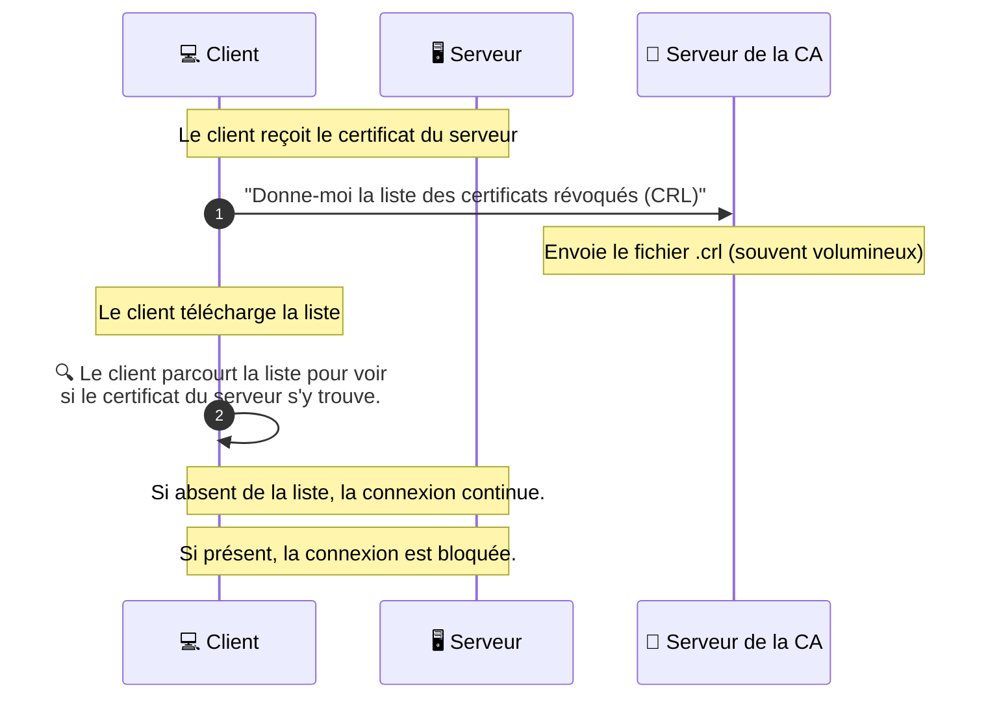

_Certificate Revocation List_

- - -
## 📌 Définition simple

Une **CRL** est une "liste noire" contenant les numéros de série de tous les certificats numériques qui ont été **révoqués** (annulés) par une Autorité de Certification ([[CA]]) avant leur date d'expiration prévue.

## ⚠️ Le problème qu'elle résout : La Révocation

Comme vu précédemment, un [[certificat]] peut devenir "dangereux" avant sa date d'expiration (vol de clé, changement de propriétaire, etc.). La CRL est le moyen pour une [[CA]] de dire au monde : *"Voici la liste des certificats que vous ne devez plus accepter"*.

## 🔄 L'analogie du "Avis de recherche"

Imagine que la police gère une liste de passeports volés :
*   **CRL :** C'est une **affiche** placardée à l'entrée du bâtiment. Pour vérifier si un voyageur est suspect, tu dois prendre l'affiche, la sortir et chercher son nom sur la liste. Si la liste est énorme, ça prend du temps.
*   **[[OCSP]] :** C'est comme appeler le poste central pour demander : *"Le voyageur avec le passeport X est-il sur la liste ?"* Ils te répondent immédiatement par téléphone.

## 🔄 Le flux de vérification 

Voici comment un client vérifie un [[certificat]] via une CRL :

## 📊 Comparaison : CRL vs OCSP

C'est la comparaison la plus importante pour ton coffre :

| Caractéristique | CRL (Certificate Revocation List) | OCSP (Online Certificate Status Protocol) |
| :--- | :--- | :--- |
| **Méthode** | **Batch** (Téléchargement d'une liste) | **Requête** (Demande individuelle) |
| **Fréquence** | Mise à jour périodique (ex: toutes les 24h) | Temps réel |
| **Taille des données** | Peut devenir très volumineuse | Très léger (une seule réponse) |
| **Vitesse** | Rapide une fois la liste téléchargée | Dépend de la latence réseau vers la CA |
| **Usage actuel** | De moins en moins utilisé pour le Web | Standard actuel pour le Web |

## 💡 Le coin du Dev : Pourquoi la CRL décline ?

Pour un développeur, il est important de savoir que la CRL a des limites techniques :
1.  **Le poids :** Si une [[CA]] a révoqué des millions de certificats, le fichier CRL peut devenir énorme, ralentissant chaque connexion au début.
2.  **La latence de mise à jour :** Si un certificat est volé à 10h00 mais que la CRL n'est mise à jour que toutes les 24h, il y a une fenêtre de vulnérabilité.

## Résumé

*   **CRL** = Une liste noire "statique" téléchargée par le client.
*   **Usage** = Moins commun aujourd'hui à cause du poids des fichiers.
*   **Complémentarité** = Elle reste une alternative ou une méthode de secours à l'[[OCSP]].
*   **Règle d'or** : Si le certificat est sur la CRL $\rightarrow$ Connexion refusée.
