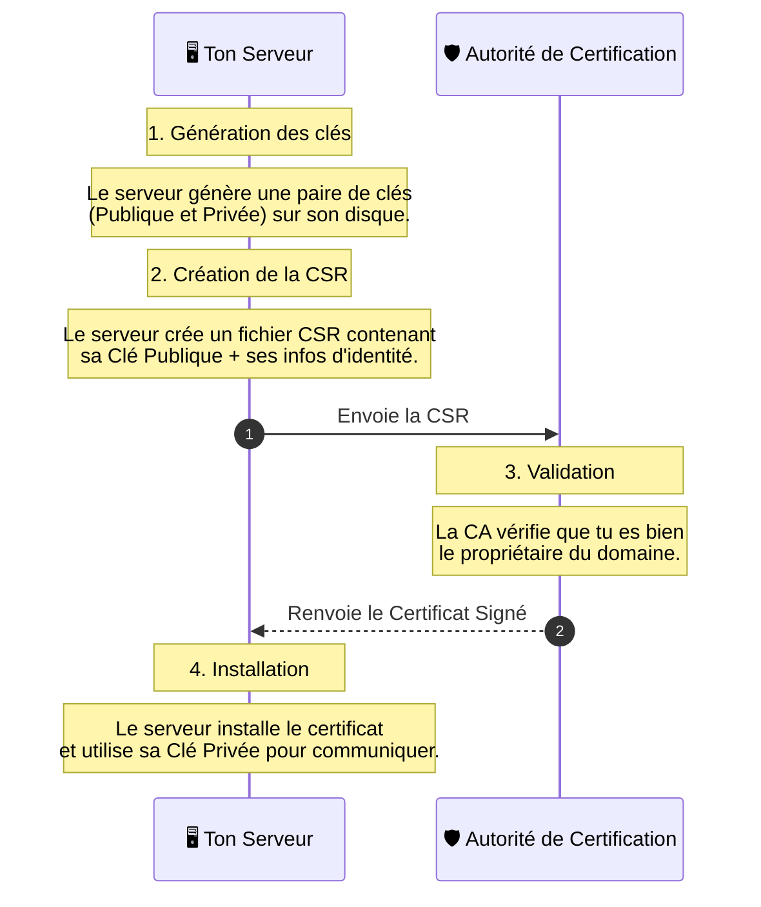

_Certificate Signing Request_

---

# 📝 CSR (Certificate Signing Request)

## 📌 Définition simple

Une **CSR** (Demande de Signature de Certificat) est un bloc de texte codé qui contient les informations nécessaires pour qu'une **Autorité de Certification ([[CA]])** puisse créer un [[certificat]] pour toi.

Si le **[[Certificat]]** est ton "Passeport" fini, la **CSR** est ton "Formulaire de demande de passeport" que tu remplis et que tu envoies à la préfecture.

## 🛂 L'analogie du Passeport

1.  **Tu prépares tes documents :** Tu rédiges ton nom, ta date de naissance et tu fournis une photo (C'est la création de la CSR).
2.  **Tu envoies le dossier :** Tu envoies ce dossier à l'État (Tu envoies la CSR à la [[CA]]).
3.  **L'État valide :** L'État vérifie tes infos et tamponne tes documents (La [[CA]] signe ton [[certificat]]).
4.  **Tu reçois le passeport :** Tu obtiens le document officiel (Tu reçois le [[Certificat]]).

## 📦 Que contient une CSR ?

Une CSR contient deux types d'informations :

1.  **Les informations d'identité (Subject) :**
    *   Le nom de domaine (ex: `mon-api.com`)
    *   L'organisation (ex: `Ma Super Entreprise`)
    *   La localisation, etc.
    
2.  **La [[Clé Publique]] :**
    *   C'est la clé publique que tu veux voir figurer sur ton certificat.

**⚠️ Point crucial de sécurité :** 

La CSR est **signée numériquement par ta [[Clé Privée]]**. 

**Pourquoi ?** 

Cela prouve à la CA que tu possèdes bien la clé privée correspondante à la clé publique que tu es en train de leur demander de certifier. Si tu ne possèdes pas la clé privée, tu ne peux pas "signer" la demande.

## 🔄 Le flux de création

Voici comment cela se passe concrètement quand tu configures un serveur :

## 💻 Le coin du Développeur (Outils)

En tant que développeur, tu ne manipules pas la CSR à la main. Tu utiliseras généralement des outils comme **[[OpenSSL]]**.

Sur Linux (ubuntu), la commande type ressemble à ceci :

`openssl req -new -newkey rsa:2048 -nodes -keyout mon_serveur.key -out mon_serveur.csr`

*   `mon_serveur.key` : C'est ta **[[Clé Privée]]** (À GARDER SECRÈTE !).
*   `mon_serveur.csr` : C'est ta **Demande** (À envoyer à la [[CA]]).

## 📝 Résumé 

*   **CSR = Formulaire de demande.** On ne l'affiche jamais publiquement sur le site web.
*   **Contenu = Identité + [[Clé Publique]].**
*   **Signature = Preuve de possession.** On signe la CSR avec la [[Clé Privée]] pour prouver qu'on est le "vrai" propriétaire.
*   **Workflow :** Générer les clés $\rightarrow$ Créer la CSR $\rightarrow$ Envoyer à la [[CA]] $\rightarrow$ Recevoir le [[Certificat]].

