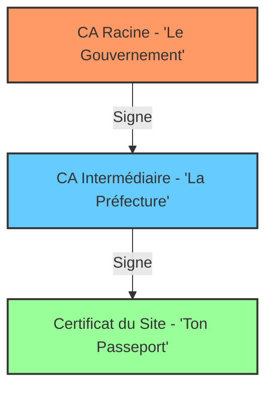
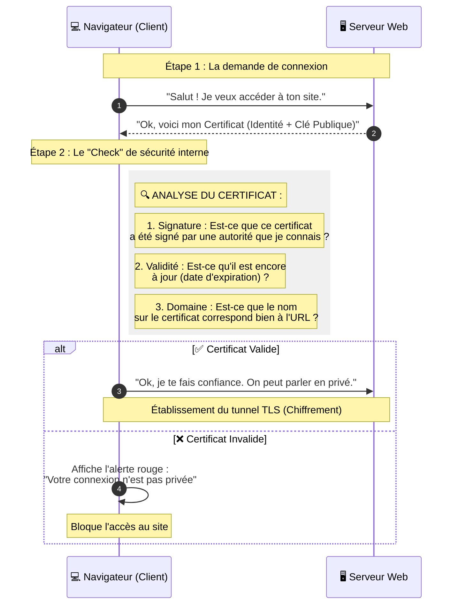

_Certificat Numérique (Digital Certificate)_

---

## 📌 Définition simple

Un **certificat numérique** est une **carte d'identité numérique**. 
C'est un fichier électronique qui lie une **identité** (un nom de domaine comme `google.com` ou une personne) à une **[[clé publique]]** spécifique. 

Il sert à prouver que "la [[clé publique]] que tu vois appartient bien au propriétaire que tu penses être".

## 🛂 L'analogie du Passeport

Pour comprendre un certificat, imagine un **passeport physique** :
1.  **L'identité :** Ton nom, ta photo, ta date de naissance (C'est le nom du site et sa clé publique).
2.  **La signature :** Le tampon officiel du gouvernement (C'est la signature de l'Autorité de Certification).
3.  **La confiance :** Tu fais confiance au passeport parce que tu fais confiance au gouvernement qui l'a délivré.

**Sans certificat :** Quelqu'un pourrait te montrer une carte d'identité faite maison. Tu as la clé publique, mais tu n'as aucune preuve qu'elle appartient à la vraie banque.
**Avec certificat :** Le gouvernement (une autorité de confiance) a "tamponné" le document pour dire : *"Je certifie que cette clé publique appartient bien à cette banque"*.

## 📦 Que contient un certificat ? 

Même si c'est un fichier complexe, un certificat contient principalement :
*   **Le Sujet :** Le nom du propriétaire (ex: `www.tonsite.com`).
*   **La [[Clé Publique]] :** La clé utilisée pour chiffrer les données.
*   **L'Émetteur :** Qui a délivré le certificat (ex: Let's Encrypt, DigiCert).
*   **La Date d'expiration :** Jusqu'à quand le certificat est valide.
*   **La [[Signature]] Numérique :** La preuve cryptographique que l'émetteur a bien validé ce certificat.

## 🔗 La Chaîne de Confiance (Chain of Trust)

C'est ici que la magie opère. Comment ton navigateur sait-il que le certificat de `google.com` est vrai ? Il utilise une **chaîne**.

1.  **Certificat de Site :** Signé par une autorité intermédiaire.
2.  **Certificat Intermédiaire :** Signé par une Autorité de Certification (CA) racine.
3.  **[[CA|CA]] Racine (Root CA) :** C'est le sommet de la pyramide.

**Le secret :** Ton système d'exploitation (Ubuntu) et ton navigateur possèdent déjà une liste de "CA Racines" de confiance pré-installées. Si la chaîne remonte jusqu'à l'une de ces racines, le site est considéré comme sûr.

### Schéma de la Chaîne de Confiance

## 🔄 Le flux de vérification 

Voici ce qui se passe quand tu tapes `https://tonsite.com` (en [[TLS]] simple):

## 📝 Résumé 

*   **Certificat ≠ Clé Privée :** Le certificat contient la clé publique. La clé privée reste secrète sur le serveur.
*   **Certificat ≠ Identité seule :** Un certificat sans signature d'une [[CA|autorité de confiance]] n'a aucune valeur de sécurité.
*   **CA ([[CA]]) :** Ce sont les "notaires" d'Internet. Ils vérifient l'identité des gens et signent leurs certificats.
