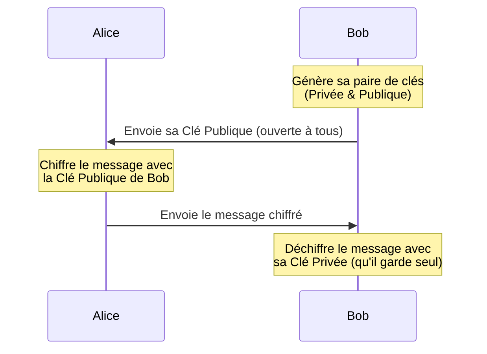

_On parle ici du chiffrement asymétrique_

_Objectif : "Je veux que seul Bob puisse lire ce que j'envoie."_
- - - 

Ici, on utilise la **[[Clé Publique]] du destinataire** (ici Bob).

**Ce qu'il faut retenir :** Si Alice veut envoyer un secret à Bob, elle doit "verrouiller" le message avec le cadenas de Bob ([[Clé Publique]]). Seul Bob possède la clé pour ouvrir ce cadenas ([[Clé Privée]]).