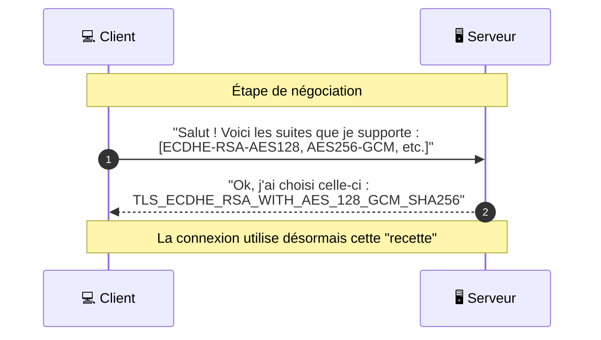

_Suite de chiffrement_

---

## 📌 Définition simple

Une **Cipher Suite** est une "recette de cuisine" ou un ensemble d'algorithmes que le client et le serveur s'accordent pour utiliser durant une session [[TLS]]. 

Elle définit exactement **comment** la connexion va être sécurisée en combinant plusieurs techniques de cryptographie.

## 🍳 L'analogie de la "Recette de Cuisine"

Imagine que tu veux cuisiner un plat spécifique. Pour ce faire, tu as besoin de choisir :
1.  **Le mode de cuisson** (ex: au four, à la vapeur).
2.  **L'outil principal** (ex: une plaque, une casserole).
3.  **L'assaisonnement** (ex: sel, poivre).

Une Cipher Suite, c'est la même chose pour une connexion web : elle définit le mode d'échange de clés, l'outil d'authentification, la méthode de chiffrement des données et le type de hachage pour l'intégrité.

## 🔍 Anatomie d'une Cipher Suite

Prenons un exemple très courant que tu pourrais voir dans les logs d'un serveur :
`TLS_ECDHE_RSA_WITH_AES_128_GCM_SHA256`

On peut la découper en 4 parties distinctes :

1.  **Échange de clés (Key Exchange) : `ECDHE`**
    *   *Rôle :* Comment on va créer la clé de session.
    *   *Ici :* Utilise le protocole Diffie-Hellman sur courbes elliptiques (ECDHE). C'est ce qui permet le **PFS** (Perfect Forward Secrecy).

2.  **Authentification : `RSA`**
    *   *Rôle :* Comment on vérifie l'identité du serveur.
    *   *Ici :* Utilise la clé publique contenue dans le certificat (basée sur l'algorithme RSA).

3.  **Chiffrement de masse (Bulk Encryption) : `AES_128_GCM`**
    *   *Rôle :* Comment on chiffre réellement les données (le contenu des pages web, les fichiers, etc.).
    *   *Ici :* Utilise l'algorithme AES avec une clé de 128 bits et le mode GCM (qui garantit aussi l'intégrité).

4.  **Hachage (MAC) : `SHA256`**
    *   *Rôle :* Comment on vérifie que les données n'ont pas été modifiées pendant le trajet.
    *   *Ici :* Utilise l'algorithme SHA-256 pour créer une "empreinte numérique" des données.

## 🤝 La Négociation (Le choix de la suite)

Pendant le **[[TLS]] [[Handshake]]**, le client et le serveur ne choisissent pas la suite au hasard.

1.  Le **Client** envoie une liste de toutes les Cipher Suites qu'il supporte (ses préférences).
2.  Le **Serveur** regarde cette liste et choisit la suite qu'il préfère parmi celles qu'il supporte aussi (souvent la plus sécurisée et la plus rapide).
3.  Ils s'accordent sur cette suite et commencent la connexion.

### Schéma de la négociation

## ⚠️ TLS 1.2 vs TLS 1.3 

C'est un point clé pour un développeur :
*   **TLS 1.2 :** Il existe des centaines de combinaisons possibles. C'est complexe et parfois risqué car de vieilles suites (faibles) peuvent être choisies par erreur.
*   **TLS 1.3 :** Le protocole a été simplifié. Il ne supporte plus que quelques suites de chiffrement très robustes et rapides (toutes supportent par défaut le PFS). Les noms sont aussi plus courts (ex: `TLS_AES_128_GCM_SHA256`).

## Résumé

*   **Cipher Suite** = La liste des algorithmes utilisés pour une session [[TLS]].
*   **Composition** = [[Key Exchange|Échange de clés]] + Authentification + [[Chiffrement]] + Hachage.
*   **Négociation** = Le client propose, le serveur choisit.
*   **Objectif** = Trouver le meilleur compromis entre sécurité maximale et performance pour les deux machines.
