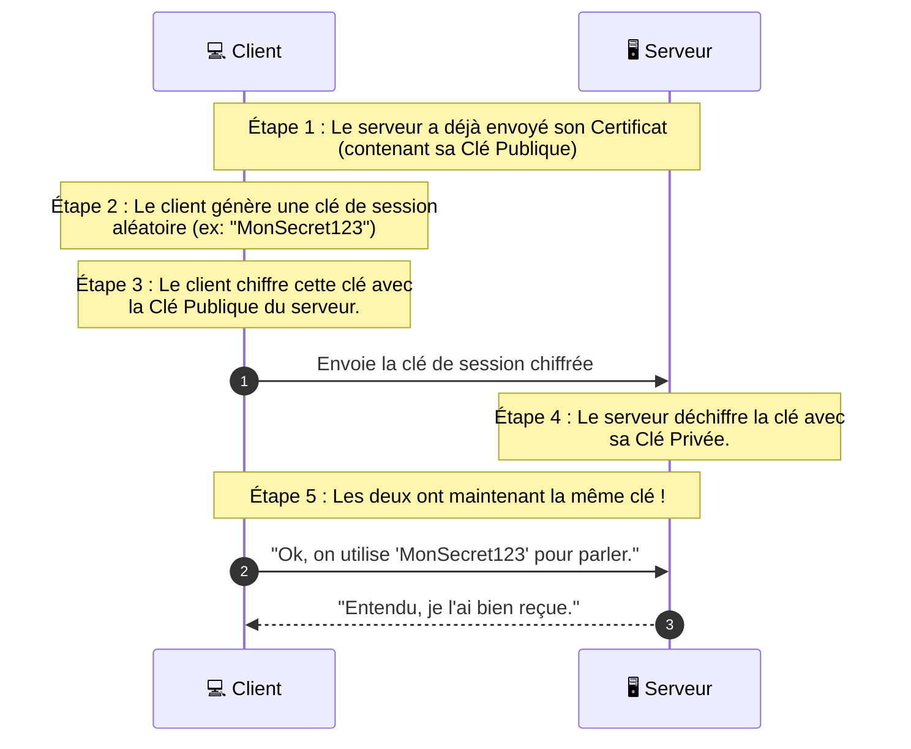

_Clé de Session TLS (Session Key)_

- - -
## 📌 Définition simple

Une **clé de session** est une clé de [[Cryptographie Symétrique]] (ou [[Clé Secrète]]) générée **temporairement** pour une seule session de communication entre un client et un serveur ([[TLS]]).

Une fois que la session est terminée (quand tu fermes l'onglet ou que la connexion est coupée), cette clé est détruite et ne peut plus être réutilisée.

## 🚀 Pourquoi ne pas utiliser la [[Clé Publique]] tout le temps ?

C'est la question la plus importante pour comprendre le [[TLS]].

Si nous utilisions la **cryptographie asymétrique** (Clé Publique/Privée) pour envoyer toutes nos données (tes messages, tes photos, tes vidéos) :

1. **Ce serait extrêmement lent :** Le calcul mathématique derrière l'asymétrique est très gourmand en ressources CPU.
2. **Ce serait inefficace :** Pour des fichiers volumineux, le temps de traitement serait prohibitif.

**La solution :** On utilise l'asymétrique uniquement pour "se mettre d'accord" sur une clé secrète, puis on utilise la symétrique (très rapide) pour le reste du trajet.

## 🔄 Le flux de création 

Voici comment la clé de session est "transmise" sans qu'un pirate puisse l'intercepter :

## 💎 Caractéristiques clés

- **Symétrique :** Une seule clé est utilisée pour chiffrer et déchiffrer les données une fois qu'elle est établie.
- **Éphémère :** Elle n'existe que pour la durée de la session. Si un pirate réussit à voler cette clé, il ne pourra lire que les données de _cette_ session précise, pas les précédentes ni les suivantes.
- **Aléatoire :** Elle est générée de manière totalement aléatoire à chaque nouvelle connexion.

## 📝 Résumé

- **Le but :** Combiner la **sécurité** de l'asymétrique avec la **vitesse** du symétrique.
- **Le rôle :** Elle est le "code secret" temporaire que le client et le serveur s'échangent au début du [[TLS]] [[Handshake]].
- **Le cycle de vie :** Création →→ Échange sécurisé (via [[Clé Publique]]) →→ Utilisation (Symétrique) →→ Destruction.