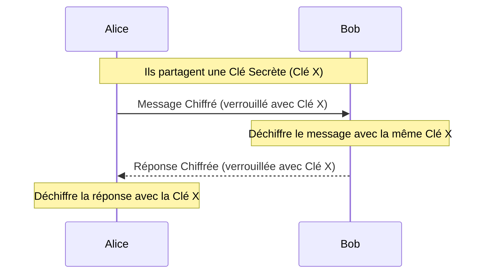

---

## 📌 Définition simple

La **cryptographie symétrique** est une méthode de chiffrement où **une seule et même clé** est utilisée à la fois pour **verrouiller** et pour **déverrouiller** (déchiffrer) une information. C'est la forme la plus ancienne et la plus simple de cryptographie.

## 🔑 L'analogie du coffre-fort

Imagine un coffre-fort physique avec une seule clé. 
1. Tu mets un document dedans et tu verrouilles le coffre avec ta clé.
2. Pour que ton ami puisse lire le document, tu dois lui donner **la même clé**.
3. Une fois qu'il a la clé, il peut ouvrir le coffre.

**Le problème :** Comment lui donner la clé sans qu'un voleur ne la récupère pendant le transport ? C'est ce qu'on appelle le **problème de distribution des clés**.

## 🔄 Schéma de fonctionnement 

Dans ce scénario, Alice et Bob ont déjà réussi à s'échanger une [[Clé Secrète]] de manière sécurisée (par exemple, ils se sont vus en personne).

## 🚀 Avantages et Inconvénients

### ✅ Avantages :
*   **Rapidité extrême :** C'est beaucoup plus rapide que la cryptographie asymétrique.
*   **Efficacité :** Idéal pour chiffrer de gros volumes de données (vidéos, fichiers, flux de données en continu).

### ❌ Inconvénients :
*   **Le problème de la confiance :** Si tu veux communiquer avec quelqu'un à l'autre bout du monde (comme un serveur web), comment lui envoyer la clé secrète sans qu'elle soit interceptée ?
*   **Gestion des clés :** Si tu dois parler à 1000 personnes différentes, tu dois gérer 1000 clés différentes.

## 🔗 Lien avec [[TLS]] (Le concept "Hybride")

C'est ici que tout s'assemble :
1. On utilise la **Cryptographie Asymétrique** pour résoudre le problème de la confiance (échanger une clé secrète sans se voir).
2. Une fois que les deux machines ont "convenu" d'une clé secrète, elles passent à la **Cryptographie Symétrique** pour discuter, car c'est beaucoup plus rapide.
