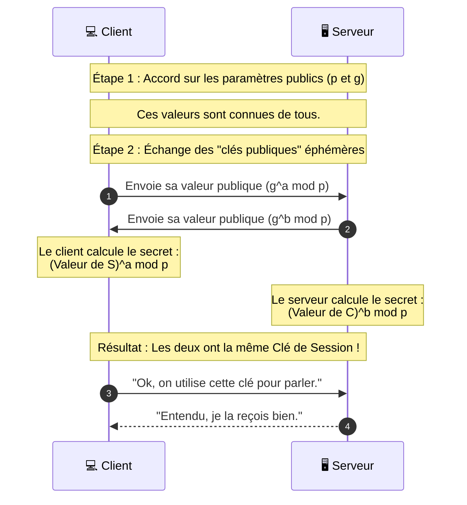

---

## 📌 Définition simple

**Diffie-Hellman** est un protocole de cryptographie qui permet à deux parties (un client et un serveur, par exemple) de convenir d'une **clé secrète commune** en communiquant sur un canal public et non sécurisé (comme Internet).

Le plus impressionnant ? **La clé secrète n'est jamais envoyée sur le réseau.** Elle est calculée simultanément par les deux parties de leur côté.

## 🎨 L'analogie des couleurs (La plus efficace)

Pour comprendre comment on peut créer un secret sans le transmettre, imagine que Alice et Bob veulent créer une couleur secrète :

1.  **Accord public :** Ils s'entendent sur une couleur de base publique (ex: **Jaune**). Tout le monde peut voir cette couleur.
2.  **Secrets privés :** Alice choisit une couleur secrète (ex: **Rouge**) et Bob une autre (ex: **Bleu**). Ils ne les disent à personne.
3.  **Mélange public :** 
    *   Alice mélange le Jaune + son Rouge $\rightarrow$ Elle obtient de l'**Orange**. Elle envoie l'Orange à Bob.
    *   Bob mélange le Jaune + son Bleu $\rightarrow$ Il obtient du **Vert**. Il envoie le Vert à Alice.
4.  **Mélange final :**
    *   Alice prend le Vert de Bob et ajoute son Rouge secret $\rightarrow$ Elle obtient un **Marron foncé**.
    *   Bob prend l'Orange d'alice et ajoute son Bleu secret $\rightarrow$ Il obtient le **même Marron foncé**.

**Résultat :** Ils ont maintenant la même couleur finale. Un espion qui a vu passer l'Orange et le Vert ne peut pas facilement deviner le Marron final, car il ne connaît pas les couleurs secrètes (Rouge et Bleu) qu'Alice et Bob ont gardées pour elles.

## 🧮 Le principe mathématique (Vulgarisé)

En informatique, on n'utilise pas des couleurs mais des **nombres**. Le protocole repose sur le problème du **Logarithme Discret**.

*   **L'opération facile :** Il est très rapide pour un ordinateur de calculer $g^a \pmod p$ (une puissance avec un modulo).
*   **L'opération difficile :** Il est extrêmement long et complexe pour un ordinateur de faire l'inverse : si on connaît le résultat, trouver $a$ est presque impossible pour de très grands nombres.

## 🔄 Schéma du flux DH

Voici comment cela se traduit concrètement dans un échange de données :

## ⚠️ La grande faiblesse : L'attaque de l'homme du milieu (MitM)

Diffie-Hellman a un défaut majeur : **il ne prouve pas l'identité de l'autre.**

Si Alice pense parler à Bob, mais qu'un pirate (Mallory) s'interpose :
1.  Alice fait un DH avec Mallory (pensant que c'est Bob).
2.  Mallory fait un DH avec Bob (pensant que c'est Alice).
3.  Mallory peut maintenant lire et modifier tous les messages entre les deux.

**C'est pour cela que le [[TLS]] utilise les Certificats :**
Le TLS utilise Diffie-Hellman pour *créer la clé*, mais il utilise les Certificats (Signatures RSA/ECDSA) pour *vérifier l'identité* de celui avec qui on fait le Diffie-Hellman.

## 📊 Diffie-Hellman vs [[ECDHE]]

Comme nous l'avons vu précédemment, aujourd'hui on utilise presque toujours **ECDHE** :
*   **DH** = Utilise de très grands nombres (lent, nécessite des clés de 2048 bits ou plus).
*   **ECDH** = Utilise les courbes elliptiques (beaucoup plus rapide, sécurité équivalente avec des clés plus petites).
*   **Le "E" (Ephemeral)** = Signifie que les clés sont jetées après chaque session, garantissant le **PFS**.

## Résumé

*   **Diffie-Hellman** = Une méthode pour créer un secret commun sans jamais l'envoyer sur le réseau.
*   **Mécanisme** = Basé sur la difficulté mathématique de la factorisation et des logarithmes discrets.
*   **Avantage** = Permet d'établir une clé de session de manière très sécurisée.
*   **Limite** = Ne vérifie pas l'identité (nécessite un certificat pour être complet).
*   **Standard actuel** = **ECDHE** (la version courbe elliptique et éphémère).
