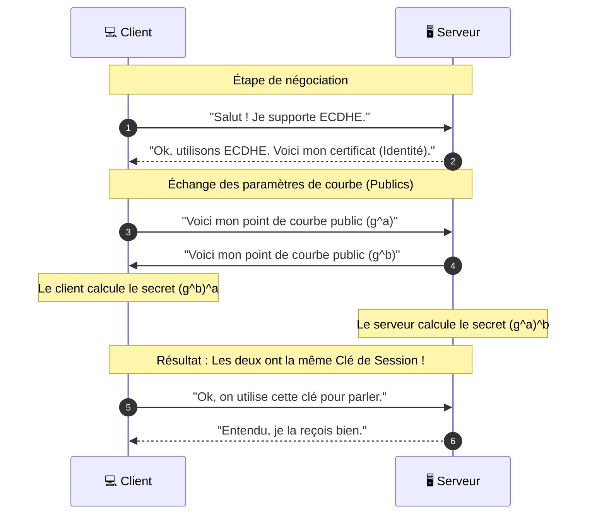

_Elliptic Curve Diffie-Hellman Ephemeral_

---

## 📌 Définition simple

**ECDHE** est une variante du protocole Diffie-Hellman qui utilise la **cryptographie sur les courbes elliptiques (ECC)** et qui génère des clés **éphémères** pour chaque session. 

C'est le standard actuel pour établir des clés de session sécurisées sur le Web (TLS 1.2 et 1.3).

## 🧩 Pourquoi "ECDHE" ? (Décryptage du nom)

Pour comprendre ECDHE, il faut le découper en trois parties :

1.  **EC (Elliptic Curve) :** Au lieu d'utiliser de très grands nombres (comme dans le DH classique), on utilise les propriétés géométriques des courbes elliptiques.
2.  **DH (Diffie-Hellman) :** On utilise le principe de base de Diffie-Hellman (créer un secret commun sans l'envoyer).
3.  **E (Ephemeral) :** Les clés sont créées à la volée et jetées dès que la session est finie.

## 🎨 L'analogie de la courbe (Simplifiée)

Imagine une courbe complexe dessinée sur un graphique. 
*   Le point de départ est public.
*   Le "secret" est une direction et une distance sur cette courbe.
*   Si tu multiplies la direction d'Alice par la courbe, tu obtiens un point public.
*   Si tu multiplies la direction de Bob par la courbe, tu obtiens un autre point public.
*   Magie mathématique : Si Alice prend le point de Bob et lui applique son secret, elle arrive au même point final que si Bob prendait celui d'Alice et lui appliquait son secret.

**L'avantage :** La géométrie des courbes permet d'obtenir une sécurité bien plus forte avec des calculs beaucoup plus légers.

## 🚀 Pourquoi est-ce meilleur que le DH classique ?

### 1. Performance et Vitesse (Le "EC")
Pour obtenir le même niveau de sécurité qu'une clé **RSA de 3072 bits** (très lourde), on n'a besoin que d'une clé **ECC de 256 bits**.
*   **Moins de données à envoyer** sur le réseau.
*   **Moins de CPU** consommé par le serveur (ce qui permet de gérer plus de connexions simultanées).

### 2. Sécurité maximale (Le "E" pour Éphémère)

C'est ici qu'intervient le **Perfect Forward Secrecy (PFS)**. 
Puisque les clés sont générées uniquement pour une session précise et ne sont jamais enregistrées sur le disque dur du serveur :
*   Si un pirate vole les clés privées du serveur demain, il ne pourra **jamais** déchiffrer les données d'aujourd'hui.
*   Le serveur ne possède aucune "clé maîtresse" pour déchiffrer le passé.

## 🔄 Schéma de flux ECDHE dans le Handshake
Voici comment il s'intègre dans la poignée de main TLS :

## 📊 Comparaison finale : RSA vs DH vs ECDHE

| Caractéristique | RSA | Diffie-Hellman (DH) | ECDHE |
| :--- | :--- | :--- | :--- |
| **Type de calcul** | Factorisation de nombres | Logarithmes discrets | Courbes Elliptiques |
| **Vitesse** | Lente | Moyenne | **Très Rapide** |
| **Taille des clés** | Très grande (3072+ bits) | Grande (2048+ bits) | **Petite (256 bits)** |
| **Forward Secrecy** | ❌ Non (en mode classique) | ✅ Oui | ✅ Oui |
| **Standard actuel** | Utilisé pour l'identité | En déclin | **Le standard du Web** |

## Résumé
*   **ECDHE** = Le "Gold Standard" actuel pour l'échange de clés TLS.
*   **EC** = Permet d'être plus rapide et plus léger (moins de bande passante).
*   **DH** = Permet de créer un secret commun sans le transmettre.
*   **E** = Garantit que le passé reste secret (PFS).
*   **Règle d'or** : Si tu vois `TLS_ECDHE_RSA_WITH_AES_128_GCM_SHA256` dans un certificat ou une config, c'est que le serveur utilise ECDHE pour créer la clé et RSA pour prouver son identité.

---

**Tu as maintenant une compréhension parfaite des mécanismes de création de clés. Tu as terminé le module "Cryptographie et Handshake" !**