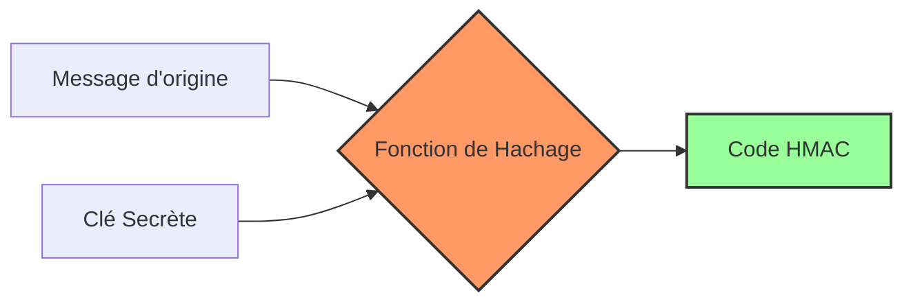

_Hash-based Message Authentication Code_

---

## 📌 Définition simple

Le **HMAC** est un mécanisme qui combine une **fonction de [[hachage]]** (comme SHA-256) et une **[[clé secrète]]** pour garantir deux choses simultanément sur un message :
1.  **L'Intégrité :** Le message n'a pas été modifié pendant le transport.
2.  **L'Authenticité :** Le message provient bien de l'expéditeur légitime (celui qui possède la clé).

## ⚠️ Le problème : Pourquoi le hachage seul ne suffit pas ?

Imagine que tu envoies un message à un ami avec un simple hachage (ex: SHA-256) pour vérifier qu'il n'a pas été modifié.

1.  Tu envoies : `Message` + `Hash(Message)`.
2.  Un pirate intercepte le message.
3.  Il modifie le `Message` (ex: change "Donne-moi 10€" en "Donne-moi 1000€").
4.  Le pirate recalcule le nouveau hash : `Hash(Nouveau Message)`.
5.  Ton ami reçoit le message modifié avec le hash correspondant. **Pour lui, le hash est valide !**

**Le problème :** Le pirate a pu modifier le contenu car il n'y avait aucune preuve que le hash avait été généré par *toi* précisément.

## ✅ La solution : Le HMAC

Pour empêcher cela, on ajoute une **clé secrète** connue uniquement par l'expéditeur et le destinataire.

Au lieu de faire `Hash(Message)`, on fait `HMAC(Clé Secrète, Message)`.

Maintenant, si le pirate modifie le message, il ne peut pas recalculer le HMAC correct car il ne possède pas la clé secrète. Si le destinataire reçoit un HMAC qui ne correspond pas au message, il sait que soit le message a été modifié, soit l'expéditeur n'est pas légitime.

## 🔄 Schéma du flux HMAC

Voici comment le HMAC est construit (simplifié) :

*Note technique : Le HMAC ne fait pas juste `Hash(Clé + Message)`. Il utilise un processus de "double hachage" interne pour éviter certaines failles mathématiques (attaques par extension de longueur), mais pour ton coffre, retiens que c'est la combinaison d'une clé et d'un hash.*

## 📊 Comparaison : Hash vs HMAC vs [[Chiffrement]]

Il est crucial de ne pas les confondre :

| Mécanisme | Cache le message ? | Vérifie l'intégrité ? | Vérifie l'identité ? |
| :--- | :--- | :--- | :--- |
| **Hachage (Hash)** | ❌ Non | ✅ Oui | ❌ Non |
| **HMAC** | ❌ Non | ✅ Oui | ✅ Oui |
| **Chiffrement** | ✅ Oui | ✅ Oui | ✅ Oui |

**En résumé :** 
*   Le **[[Chiffrement]]** est pour la **Confidentialité** (personne ne peut lire).
*   Le **HMAC** est pour l'**Authentification** et l'**Intégrité** (personne ne peut modifier ou usurper).

## 💡 Utilisation dans le [[TLS]]

Dans le protocole TLS, le HMAC est utilisé pour garantir que chaque paquet de données envoyé entre le client et le serveur n'a pas été altéré par un pirate. C'est la "signature de sécurité" qui accompagne chaque morceau de données chiffré.

## Résumé

*   **HMAC** = Hash + Clé Secrète.
*   **Objectif** = Prouver que le message est intact ET qu'il vient du bon expediteur.
*   **Différence avec le Hash** : Le hash seul est "public" ; le HMAC est "privé" (nécessite une clé).
*   **Différence avec le Chiffrement** : Le HMAC ne cache pas le contenu du message, il ne fait que le "sceller" pour prouver qu'il n'a pas été ouvert ou modifié.
