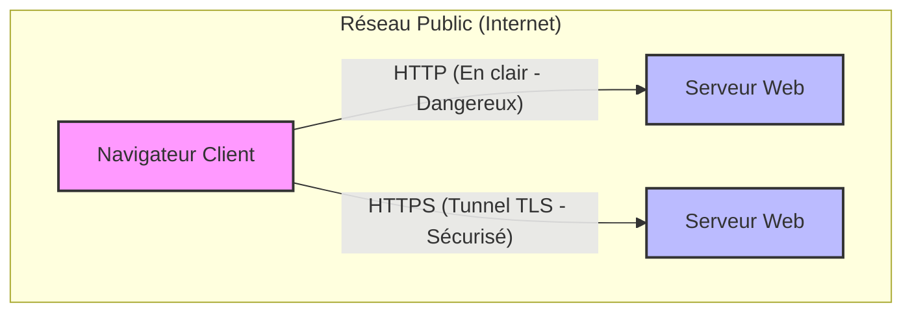

*Hypertext Transfer Protocol Secure*

## 📌 Définition simple

**HTTPS** est la version sécurisée du protocole **HTTP**. C'est le standard utilisé par presque tous les sites web modernes pour transmettre des données entre un navigateur (client) et un serveur.

## 🛠 Comment ça marche (L'analogie du tunnel)

Pour comprendre HTTPS, il faut imaginer la différence entre une lettre postale classique et un tunnel blindé :

*   **HTTP (Non sécurisé) :** C'est comme envoyer une **carte postale**. Le facteur, les voisins, ou n'importe qui peut lire le message pendant le trajet. Les données circulent "en clair".
*   **HTTPS (Sécurisé) :** C'est comme envoyer un message dans un **tunnel blindé**. Seul l'expéditeur et le destinataire ont accès à ce qui se passe à l'intérieur. Ce tunnel est créé par le protocole **[[TLS]]**.

> **En résumé :** `HTTPS = HTTP + TLS`

## 🔍 Ce que HTTPS apporte concrètement

HTTPS ne se contente pas de "cacher" les données, il apporte trois garanties essentielles :

1.  **Chiffrement (Confidentialité) :** Si un pirate intercepte les données (par exemple sur un Wi-Fi public), il ne verra qu'une suite de caractères illisibles (du "bruit").
2.  **Intégrité :** Si un pirate tente de modifier une donnée pendant son trajet (par exemple, changer le montant d'un virement bancaire dans une requête), le navigateur s'en apercevra et bloquera la connexion.
3.  **Authentification :** HTTPS permet à ton navigateur de vérifier que le site auquel tu te connectes est bien celui qu'il prétend être (grâce aux [[Certificat|certificats]]).

## 💻 Détails pour le développeur

*   **Ports :** 
    *   HTTP utilise généralement le port **80**.
    *   HTTPS utilise le port **443**.
*   **Le rôle du TLS :** Le [[TLS]] est la "couche" qui s'interpose entre la couche Application (HTTP) et la couche Transport (TCP). Il prend le flux HTTP et le "maille" dans un tunnel chiffré.
*   **Le certificat :** Pour qu'un site puisse utiliser HTTPS, il doit posséder un **Certificat SSL/TLS**. C'est ce certificat qui contient la **Clé Publique** dont nous avons parlé précédemment.

---

## 📊 Schéma comparatif

## 🌐 Sources

https://developer.mozilla.org/en-US/docs/Glossary/HTTPS