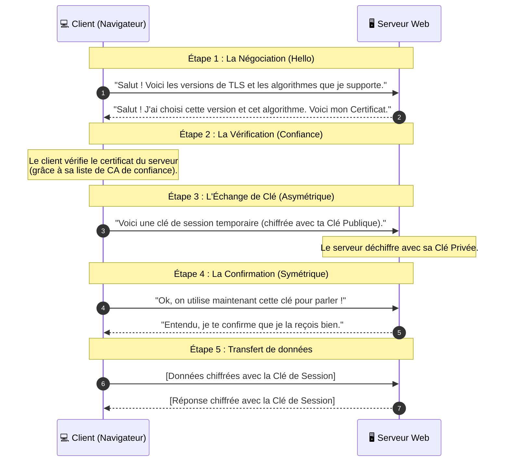

_Le TLS Handshake (La "Poignée de main")_

---
## 📌 Définition simple

Le **TLS Handshake** est la phase de négociation qui se produit au tout début d'une connexion [[HTTPS]]. C'est le moment où le client (ton navigateur) et le serveur se mettent d'accord sur **comment** ils vont communiquer de manière sécurisée.

C'est durant cette phase que les concepts de clés asymétriques, de certificats et de certificats de confiance sont utilisés.

## 💡 La logique globale : "Le meilleur des deux mondes"

Comme nous l'avons vu, le [[TLS]] veut être à la fois **sûr** et **rapide**. Le Handshake suit donc une logique en deux temps :
1.  **Phase de négociation ([[Cryptographie Asymétrique|Asymétrique]]) :** On utilise la cryptographie asymétrique pour s'échanger une clé secrète sans que personne ne puisse l'intercepter.
2.  **Phase de communication ([[Cryptographie Symétrique|Symétrique]]) :** Une fois que les deux ont la même clé secrète, ils passent en cryptographie symétrique pour le reste de la session.

## 🔄 Le flux du Handshake (Diagramme de séquence)

Voici le parcours type d'une connexion [[TLS]] (simplifié pour la compréhension) :

## 🔍 Détails des étapes clés pour le développeur

1.  **Client Hello :** Le client envoie une liste de "[[Cipher Suites]]" (combinaisons d'algorithmes de chiffrement qu'il comprend).
2.  **Server Hello :** Le serveur choisit la meilleure option commune. Il envoie aussi son **Certificat**.
3.  **Vérification :** Le client vérifie la signature du certificat (comme vu dans la note précédente). S'il n'est pas valide, la connexion s'arrête ici.
4.  **Échange de clé (Pre-Master Secret) :** C'est l'étape magique. Le client génère une clé de session aléatoire. Il la chiffre avec la **[[Clé Publique]]** du serveur (présente dans le [[certificat]]). Seul le serveur peut la déchiffrer avec sa **[[Clé Privée]]**.
5.  **[[Clé de Session|Session Keys]] :** Maintenant que les deux ont la même clé, ils ne l'utilisent plus pour le chiffrement de base, mais pour générer des clés de session uniques. Ils passent en mode **Symétrique**.

## 💡 Pourquoi est-ce si important ?

Sans ce "Handshake", on ne pourrait pas utiliser la [[cryptographie asymétrique]] pour tout (trop lent) et on ne pourrait pas utiliser la symétrique pour tout (pas assez sûr pour échanger la clé). Le Handshake est le pont qui permet de passer de l'un à l'autre en toute sécurité.

## Résumé

*   **Handshake** = La phase de négociation initiale.
*   **Asymétrique** = Utilisé uniquement pour s'échanger la clé de session (sécurité maximale).
*   **Symétrique** = Utilisé pour envoyer les données réelles (vitesse maximale).
*   **Certificat** = Utilisé durant le handshake pour prouver l'identité du serveur.
*   **[[Clé de Session]]** = Une clé temporaire créée pour une seule session, puis jetée.
