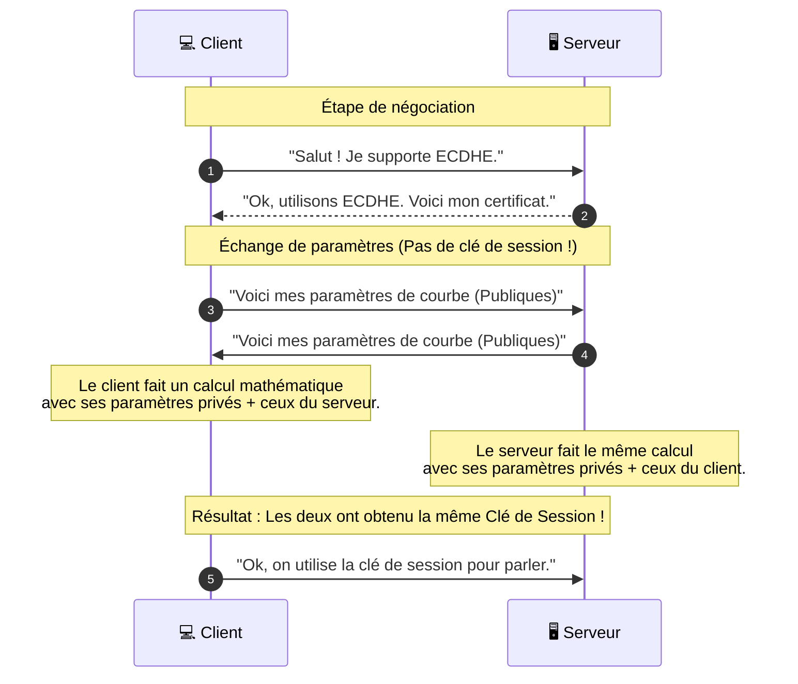

_Mécanisme d'échange de clés_
- - -

## 📌 Le problème fondamental

Comment deux personnes (un client et un serveur) peuvent-elles convenir d'un code secret sans que personne ne puisse l'intercepter pendant la conversation ?

Il existe deux grandes familles d'approches pour résoudre ce problème durant le [[TLS]] [[Handshake]].

---

## 1. L'approche [[RSA]] (L'ancienne méthode)

Dans cette approche, le client utilise la **[[Clé Publique]]** du serveur (contenue dans son [[certificat]]) pour chiffrer directement la [[clé de session]], puis l'envoie au serveur.

*   **Avantage :** Très simple à comprendre.
*   **Inconvénient majeur :** Si un pirate enregistre tout le trafic d'une session aujourd'hui, et qu'il réussit à voler la **Clé Privée** du serveur dans deux ans, il pourra déchiffrer toutes les conversations enregistrées du passé. C'est ce qu'on appelle un manque de **Perfect Forward Secrecy ([[PFS]])**.

---

## 2. L'approche [[Diffie-Hellman]] (DH)

C'est une révolution mathématique. Ici, le client et le serveur n'envoient **jamais** la clé de session sur le réseau. Ils utilisent des calculs mathématiques pour "arriver" au même résultat de leur côté.

### 🎨 L'analogie des couleurs (La plus simple pour comprendre DH)

Imagine que Alice et Bob veulent créer une couleur secrète :
1.  **Accord commun :** Ils s'entendent sur une couleur de base publique (ex: Jaune).
2.  **Secrets privés :** Alice choisit une couleur secrète (ex: Rouge) et Bob une autre (ex: Bleu). Ils ne les disent à personne.
3.  **Mélange public :** 
    *   Alice mélange Jaune + Rouge = **Orange**. Elle envoie l'Orange à Bob.
    *   Bob mélange Jaune + Bleu = **Vert**. Il envoie le Vert à Alice.
4.  **Mélange final :**
    *   Alice prend le Vert de Bob et ajoute son Rouge secret $\rightarrow$ Elle obtient un **Marron foncé**.
    *   Bob prend l'Orange d'Alice et ajoute son Bleu secret $\rightarrow$ Il obtient le **même Marron foncé**.

**Résultat :** Ils ont tous les deux la même couleur finale, mais personne n'a pu la deviner en regardant les mélanges publics (Orange et Vert) car il est mathématiquement très difficile d'extraire la couleur secrète d'un mélange.

---

## 3. L'approche ECDHE (Le standard moderne)

Aujourd'hui, presque tous les sites web utilisent **ECDHE** (*Elliptic Curve Diffie-Hellman Ephemeral*). C'est la version "améliorée" de Diffie-Hellman.

*   **Elliptic Curve (EC) :** Au lieu d'utiliser de très grands nombres (DH classique), on utilise la géométrie des courbes elliptiques. 
    *   *Avantage :* C'est beaucoup plus rapide et cela nécessite des clés beaucoup plus petites pour une sécurité équivalente.
    
*   **Ephemeral (E) :** Cela signifie que les clés sont **éphémères**. Une nouvelle paire de clés est générée pour *chaque session*.
    *   *Avantage :* C'est ce qui permet le **Perfect Forward Secrecy (PFS)**. Même si la clé privée du serveur est volée plus tard, les sessions passées restent illisibles car les clés de session ont été jetées.

---

## 📊 Tableau Comparatif pour ton coffre

| Algorithme | Type | Sécurité | Vitesse | Forward Secrecy ? | Statut actuel |
| :--- | :--- | :--- | :--- | :--- | :--- |
| **RSA** | Chiffrement direct | Moyenne | Lent | ❌ Non | En déclin |
| **DH** | Échange mathématique | Bonne | Moyen | ✅ Oui | Utilisé |
| **ECDHE** | Courbes Elliptiques | Excellente | Très Rapide | ✅ Oui | **Standard actuel** |

---

## 🔄 Schéma de flux : ECDHE dans le Handshake

Voici comment cela s'intègre dans ton diagramme de [[Handshake]] :

## 📝 Résumé

*   **Diffie-Hellman** est la méthode qui permet de créer un secret commun sans jamais l'envoyer sur le réseau.
*   **ECDHE** est la version moderne, ultra-rapide et sécurisée utilisée par 99% du web actuel.
*   **Perfect Forward Secrecy (PFS)** est la raison pour laquelle on préfère ECDHE : il garantit que le vol d'une [[clé privée]] aujourd'hui ne compromettra pas les données d'hier.
