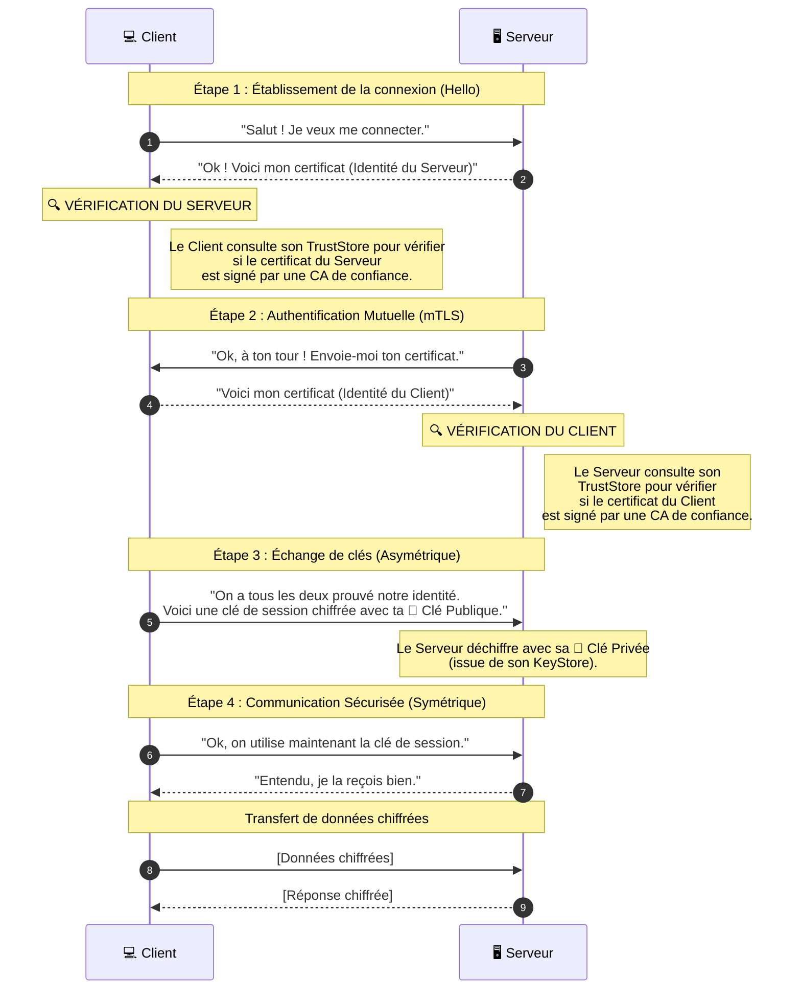

_KeyStore (Magasin de Clés)_

---

## 📌 Définition simple

Un **KeyStore** est un dépôt (un fichier ou une base de données) qui contient tes propres **identités cryptographiques**. 

C'est l'endroit où tu stockes tes **[[Clé Privée|clés privées]]** et tes **[[Certificat|certificats]] publics**. C'est ton "portefeuille" d'identité.

- - -

## ⚖️ KeyStore vs [[Trust Store]] : La différence cruciale

C'est ici que tout devient clair. Pour comprendre le KeyStore, il faut le mettre en opposition avec le TrustStore :

1.  **Key Store** = **"Qui suis-je ?"** (Mes secrets, mon identité).
    *   Contient : Ta clé privée, ton certificat public.
    *   Usage : Pour prouver au monde qui tu es.
2.  **[[Trust Store]]** = **"En qui ai-je confiance ?"** (Les identités des autres).
    *   Contient : Les clés publiques des autorités (CA) que tu acceptes.
    *   Usage : Pour vérifier l'identité des autres.

- - -
## 🛂 L'analogie du Voyageur

Imagine que tu voyages à l'étranger :
*   **Ton KeyStore, c'est ton Passeport :** Il contient ta photo, ton nom et ta signature officielle. C'est ce que tu montres aux agents pour prouver ton identité.
*   **Ton TrustStore, c'est ta Liste de Notaires :** C'est une liste que tu as dans ta poche qui dit : *"Je fais confiance aux passeports délivrés par la France, le Canada et le Japon"*. Si un agent te montre un passeport d'un pays qui n'est pas sur ta liste, tu ne le croiras pas.

- - -
## 🔄 Schéma de comparaison 

Pour bien comprendre, voyons comment ces deux éléments sont utilisés dans une connexion sécurisée (comme le mTLS).

Pour bien comprendre ce diagramme, il faut retenir cette règle d'or :

1.  **Le KeyStore est utilisé pour "S'identifier"** :
    *   Quand le **Serveur** envoie son certificat à l'étape 2, il pioche dans son **KeyStore** (il dit : *"Voici ma carte d'identité"*).
    *   Quand le **Client** envoie son certificat à l'étape 5, il pioche dans son **KeyStore** (il dit : *"Voici ma carte d'identité"*).

2.  **Le TrustStore est utilisé pour "Vérifier"** :
    *   À l'étape 3, le **Client** regarde dans son **TrustStore** pour voir s'il reconnaît le "notaire" qui a signé le certificat du serveur.
    *   À l'étape 6, le **Serveur** regarde dans son **TrustStore** pour voir s'il reconnaît le "notaire" qui a signé le certificat du client.

- - -
## 💻 Détails techniques pour le développeur

*   **Formats courants :** 
    *   **PKCS12** : C'est le format standard actuel (souvent avec l'extension `.p12` ou `.pfx`). C'est le plus utilisé aujourd'hui.
    *   **JKS (Java KeyStore)** : Un format spécifique à Java (de plus en plus remplacé par PKCS12).
    
*   **Utilisation en [[mTLS]] :** 
    *   Pour que le mTLS fonctionne, le **Client** doit avoir un **Key Store** (pour envoyer son certificat) ET un **Trust Store** (pour vérifier celui du serveur).
    *   Le **Serveur** doit aussi avoir les deux.
    
*   **Sécurité :** Le KeyStore est généralement protégé par un **mot de passe**. Si quelqu'un vole ton fichier KeyStore sans le mot de passe, il ne peut pas extraire ta clé privée.

- - -

## Résumé

*   **Key Store** = Mon coffre-fort personnel (Mes clés privées + Mes certificats).
*   **[[Trust Store]]** = Ma liste blanche (Les certificats des autorités que je valide).
*   **Différence clé :** Le Key Store sert à **s'identifier**, le [[Trust Store]] sert à **vérifier**.
*   **Lien avec [[OpenSSL]] :** Quand tu génères une clé et un certificat avec OpenSSL, tu prépares le contenu que tu mettras plus tard dans un KeyStore.
