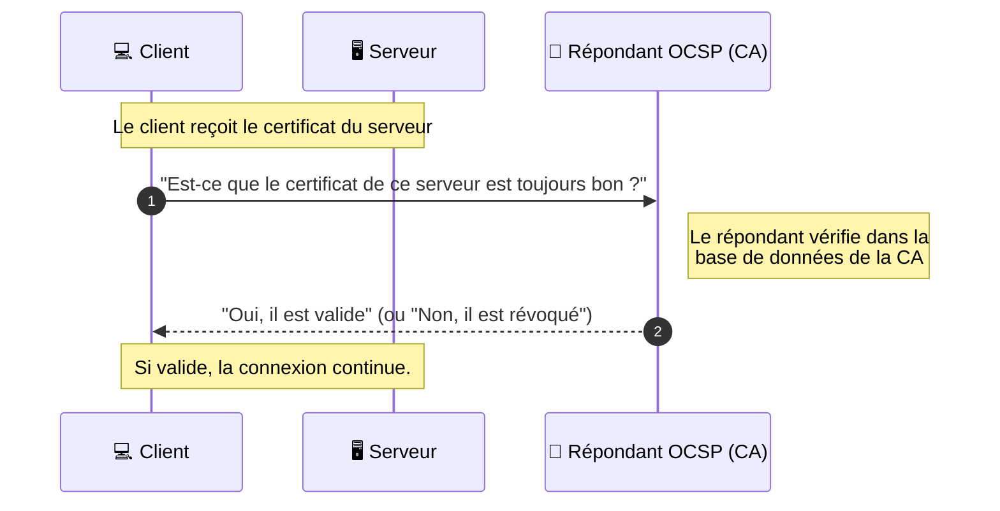

_Online Certificate Status Protocol_

---
## 📌 Définition simple

L'**OCSP** est un protocole qui permet de vérifier en **temps réel** si un certificat numérique est toujours valide ou s'il a été **révoqué** (annulé) avant sa date d'expiration.

## ⚠️ Le problème qu'il résout : La Révocation

Un [[certificat]] a une date d'expiration (ex: valide 1 an). Mais parfois, il faut l'annuler **avant** :
*   La clé privée du serveur a été volée.
*   L'entreprise a été vendue ou a changé de nom.
*   La CA a commis une erreur lors de la signature.

Si on ne vérifiait pas la révocation, un pirate qui vole une clé privée pourrait continuer à utiliser le certificat jusqu'à sa date d'expiration.

## 🔄 L'analogie du "Vérificateur"

Imagine que tu vérifies le passeport d'un voyageur :
*   **[[CRL]] (Certificate Revocation List) :** C'est comme avoir une **liste papier** de tous les passeports volés dans le monde. Tu dois la tenir à jour et la parcourir pour voir si le passeport du voyageur est dessus. (Lourd et peut être obsolète).
*   **OCSP :** C'est comme avoir une **base de données en ligne**. Tu tapes le numéro du passeport dans ton ordinateur et tu reçois une réponse immédiate : *"Valide"* ou *"Révoqué"*.

## 🔄 Le flux de vérification 

Voici comment le navigateur vérifie un certificat pendant la connexion :

## 💡 OCSP Stapling

C'est une optimisation importante :

*   **Sans Stapling :** C'est le *Client* qui doit contacter la CA (ce qui est lent et pose des problèmes de confidentialité).
*   **Avec Stapling :** C'est le *Serveur* qui demande lui-même à la CA de vérifier son certificat toutes les quelques heures. Il "agrafe" (staple) la preuve de validité sur son propre certificat et la donne au client pendant le TLS Handshake.
*   **Avantage :** C'est beaucoup plus rapide pour le client et plus respectueux de la vie privée.

## Résumé

*   **OCSP** = Vérification en temps réel de la validité d'un certificat.
*   **Objectif** = Détecter les certificats volés ou annulés avant leur date d'expiration.
*   **Avantage sur la CRL** = Plus rapide, plus précis, et plus léger (pas besoin de télécharger une liste géante).
*   **OCSP Stapling** = Le serveur fournit lui-même la preuve de validité au client (optimisation standard).
