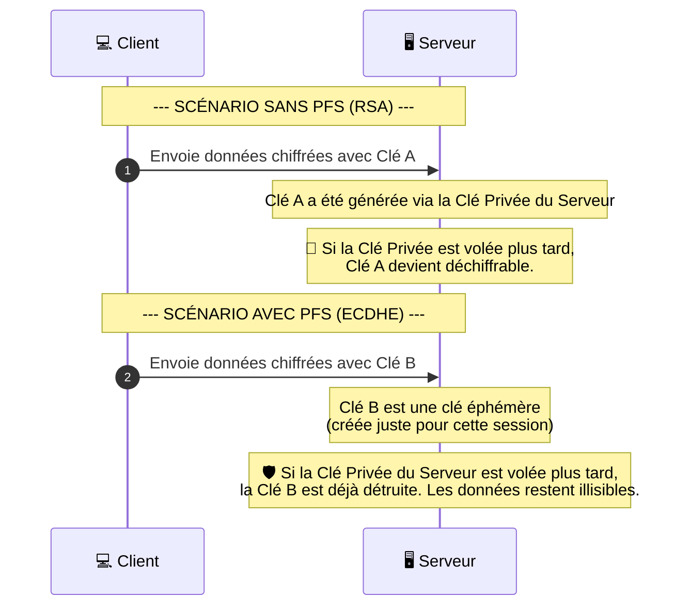

_Perfect Forward Secrecy_

---
## 📌 Définition simple

Le **PFS** (Secret Parfait Persistant) est une propriété d'un protocole de communication qui garantit que **si une [[clé privée]] est compromise aujourd'hui, les conversations passées restent illisibles.**

En d'autres termes : le vol d'une clé aujourd'hui ne permet pas de déchiffrer les données capturées hier.

## ⚠️ Le problème sans PFS (L'approche RSA classique)

Imagine un pirate qui enregistre tout le trafic sortant d'une entreprise pendant un an. 
Si le serveur utilise une méthode d'échange de clés sans PFS (comme le RSA classique) :
1. Le pirate possède des téraoctets de données chiffrées.
2. Le pirate réussit, dans un an, à voler la **Clé Privée** du serveur (par un piratage, une faille ou une saisie physique).
3. Le pirate peut alors déchiffrer **toutes les données des 12 derniers mois**.

C'est un désastre pour la confidentialité à long terme.

## ✅ La solution avec PFS (L'approche ECDHE)

Avec le PFS, le serveur n'utilise jamais sa clé privée pour chiffrer les données de la session. Il l'utilise uniquement pour **[[Signature|signer]]** l'[[Key Exchange|échange de clés]].

L'échange de clés se fait avec des **clés éphémères** (ECDHE) :

1. Pour chaque nouvelle connexion, le client et le serveur créent une nouvelle paire de clés temporaires.
2. Ils s'accordent sur une clé de session grâce à ces clés temporaires.
3. Dès que la connexion est fermée, ces clés temporaires sont **détruites**.

Même si le pirate vole la clé privée du serveur un an plus tard, il ne trouvera aucune trace des clés de session utilisées par le passé, car elles n'ont jamais été stockées et n'ont jamais circulé sur le réseau.

## 🔄 Schéma comparatif du vol d'une clé

## Résumé

*   **PFS** = Sécurité du passé.
*   **Objectif** : Empêcher qu'une compromission future ne révèle les secrets du passé.
*   **Mécanisme** : Utilisation de clés de session **éphémères** (ECDHE).
*   **Standard** = C'est le standard requis par les navigateurs modernes pour les connexions sécurisées.
