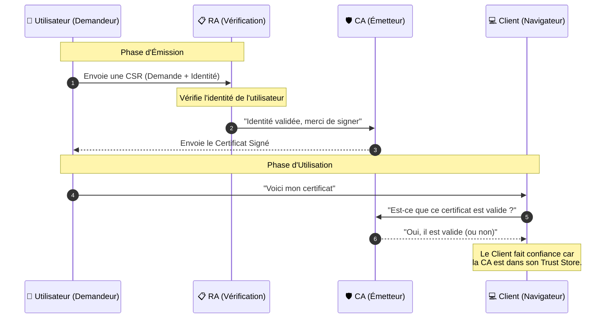

_Public Key Infrastructure_

---
## 📌 Définition simple

La **PKI** (Infrastructure à [[Clé Publique| clés publiques]]) n'est pas un logiciel, mais un **système complet** (composé de matériel, de logiciels, de procédures et de politiques) qui permet de gérer la création, la distribution, l'utilisation, le stockage et la révocation des certificats numériques.

Si le **[[Certificat]]** est ton passeport, la **PKI** est l'ensemble de l'administration publique qui gère les bureaux de passeport, les bases de données d'identité, les lois sur la validité des documents et les listes de passeports volés.

- - -
## 🧩 Les composants clés de la PKI

Pour qu'une PKI fonctionne, elle a besoin de plusieurs acteurs et outils :

1.  **[[CA]] (Certificate Authority) :** L'autorité qui signe et délivre les certificats.
2.  **RA (Registration Authority) :** Le "guichet". C'est l'entité qui vérifie l'identité du demandeur avant de dire à la CA : *"Ok, tu peux lui donner un certificat"*. (Souvent, la CA et la RA sont gérées par la même entreprise, mais ce sont deux rôles distincts).
3.  **[[Trust Store]] :** La liste des [[CA]] racines en lesquelles ton système fait confiance (vu dans la note précédente).
4.  **[[CRL]] (Certificate Revocation List) :** Une "liste noire" de certificats qui ont été annulés avant leur date d'expiration (ex: clés volées).
5.  **[[OCSP]] (Online Certificate Status Protocol) :** Un service en ligne qui permet de vérifier en temps réel si un certificat est toujours valide.

- - - 
## 🔄 Le flux de vie d'un certificat dans une PKI

Voici comment un certificat naît, vit et meurt dans une infrastructure PKI :

- - - 
## 🛠️ Pourquoi la PKI est-elle si complexe ?

On pourrait se dire : *"Pourquoi ne pas juste signer les certificats nous-mêmes ?"* 

La PKI est complexe parce qu'elle doit garantir la **confiance à grande échelle**. 
*   Si tu crées ta propre PKI (pour ton entreprise), c'est facile : tu installes ta propre CA sur tous les postes de tes employés.
*   Mais pour Internet, il faut une PKI mondiale où des milliers de personnes se mettent d'accord sur qui sont les "notaires" de confiance (les CA racines comme Let's Encrypt, DigiCert, etc.).

- - -
## 📝 Résumé

*   **PKI** = L'écosystème global de confiance.
*   **CA** = Le notaire qui signe.
*   **RA** = Le guichet qui vérifie ton identité avant la signature.
*   **CRL / OCSP** = Les mécanismes pour dire "ce certificat n'est plus bon".
*   **Objectif** : S'assurer que la clé publique que je vois appartient bien à la personne à qui je pense parler, partout dans le monde.

