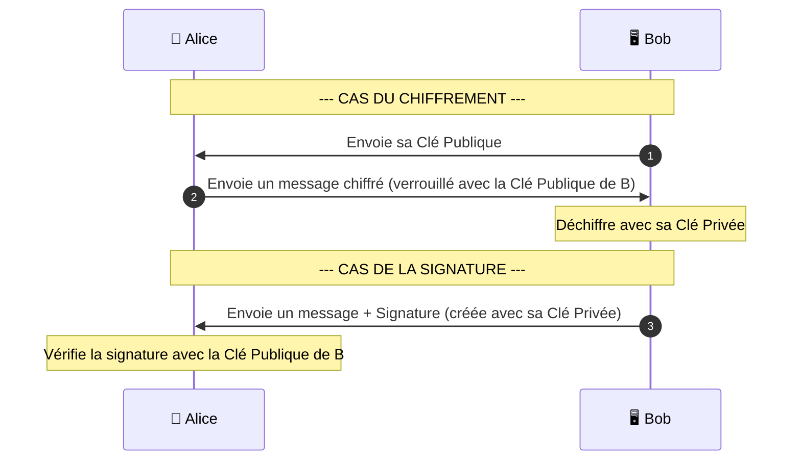

_Rivest-Shamir-Adleman_

---

## 📌 Définition simple

**RSA** est l'algorithme de [[cryptographie asymétrique]] le plus connu et le plus utilisé au monde. Il permet de créer une paire de clés (publique et privée) pour deux usages principaux :
1.  **Le [[chiffrement]] :** Verrouiller une information pour que seul le destinataire puisse la lire.
2.  **La [[signature]] numérique :** Prouver l'identité de l'expéditeur.

## 🧮 Le principe mathématique (Vulgarisé)

La sécurité du RSA repose sur une opération mathématique très simple mais "difficile" à inverser pour un ordinateur : **la factorisation des nombres premiers.**

*   **Le sens facile :** Il est très rapide pour un ordinateur de multiplier deux **nombres premiers** géants entre eux (ex: $17 \times 19 = 323$).
*   **Le sens difficile :** Il est extrêmement long et complexe pour un ordinateur de faire le chemin inverse. Si je te donne le chiffre $323$, il est difficile de deviner instantanément qu'il provient de $17 \times 19$.

Pour RSA, on utilise des **nombres premiers** si grands qu'il faudrait des milliers d'années aux ordinateurs actuels pour trouver les **facteurs** d'un produit donné.

## 🔄 Comment ça marche ?

### 1. Pour le Chiffrement (Confidentialité)
*   **Alice** veut envoyer un secret à **Bob**.
*   **Bob** lui donne sa **[[Clé Publique]]**.
*   **Alice** utilise cette clé pour verrouiller son message.
*   **Bob** utilise sa **[[Clé Privée]]** pour déverrouiller le message.

### 2. Pour la Signature (Authenticité)
*   **Bob** veut prouver que c'est bien lui qui a envoyé un message.
*   **Bob** "signe" le message avec sa **[[Clé Privée]]**.
*   **Alice** reçoit le message et la signature. Elle utilise la **[[Clé Publique]]** de Bob pour vérifier la signature.
*   Si la vérification fonctionne, elle est certaine que c'est bien Bob qui a signé.

### Schéma du flux RSA

## ⚠️ Les limites du RSA aujourd'hui

Bien que révolutionnaire, le RSA a deux défauts majeurs qui expliquent pourquoi on utilise d'autres méthodes (comme [[ECDHE]]) pour l'échange de clés :

1.  **La lenteur :** Les calculs mathématiques sur de très grands nombres sont gourmands en CPU. C'est beaucoup plus lent que la cryptographie symétrique.
2.  **L'absence de [[PFS]] (Perfect Forward Secrecy) :** Si tu utilises RSA pour échanger ta [[clé de session]] (méthode ancienne), et que quelqu'un vole la [[clé privée]] du serveur dans 2 ans, il pourra déchiffrer toutes les conversations enregistrées depuis aujourd'hui.

## 💡 RSA dans le [[TLS]] moderne

Aujourd'hui, RSA est encore très utilisé, mais son rôle a changé :
*   **Il ne sert plus à échanger les clés de session** (on utilise [[ECDHE]] pour cela, car c'est plus rapide et sécurisé).
*   **Il sert à l'Authentification :** Il est utilisé pour signer les certificats et prouver l'identité du serveur lors du Handshake.

## Résumé

*   **RSA** = Le standard historique de la cryptographie asymétrique.
*   **Principe** = Basé sur la difficulté de factoriser de grands nombres premiers.
*   **Usage** = Identité ([[Signature]]) et [[Chiffrement]] de petites données (comme une [[clé de session]]).
*   **Statut actuel** = Toujours présent dans le [[TLS]] pour l'identité, mais remplacé par [[ECDHE]] pour l'échange de clés.

