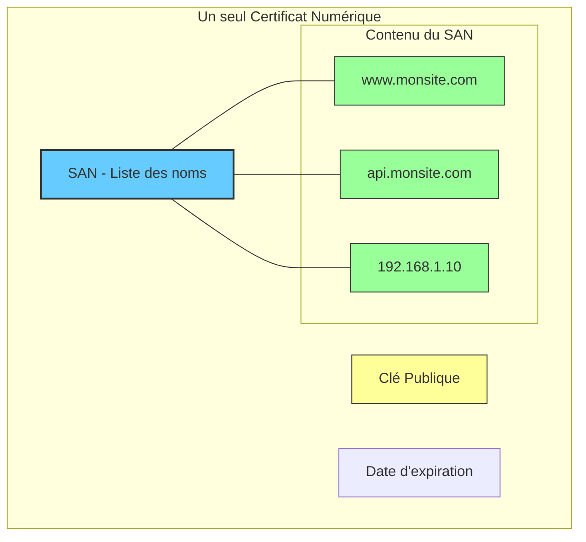

_Subject Alternative Name_

---
## 📌 Définition simple

Le **SAN** est une "extension" d'un [[certificat]] numérique ([[X.509]]) qui permet d'associer **plusieurs noms** (identités) à un seul [[certificat]].

C'est ce qui permet à un certificat d'être valide pour `www.monsite.com`, `monsite.com`, et même pour une adresse IP comme `192.168.1.10`, tout en n'utilisant qu'un seul fichier de certificat.

## 📜 Pourquoi le SAN existe-t-il ? (Le problème du CN)

À l'origine, les certificats utilisaient un champ appelé **CN (Common Name)**.
*   Le CN ne pouvait contenir qu'**un seul nom** (ex: `monsite.com`).
*   Si tu voulais que ton certificat soit aussi valide pour `www.monsite.com`, tu devais acheter deux certificats différents.

C'était une limitation majeure. Le SAN a été créé pour résoudre ce problème en permettant d'ajouter une "liste alternative" de noms au certificat.

## 🛂 L'analogie du "Badge Multi-Accès"

Imagine un badge d'entreprise :
*   **Sans SAN :** Ton badge ne fonctionne que pour l'entrée du "Bâtiment A". Si tu veux entrer dans le "Bâtiment B", tu dois demander un deuxième badge.
*   **Avec SAN :** Ton badge contient une liste de zones autorisées : "Bâtiment A", "Bâtiment B", "Cantine", "Parking". Un seul badge, plusieurs accès.

## 📊 Types d'identités dans un SAN

Un champ SAN peut contenir plusieurs types d'informations :
1.  **DNS Names :** Les noms de domaine (ex: `api.monsite.com`, `dev.monsite.com`).
2.  **IP Addresses :** Les adresses IP brutes (ex: `10.0.0.5`).
3.  **URIs :** Des identifiants spécifiques pour des services.

### Schéma : Un certificat couvrant plusieurs identités



## 💻 Détails techniques pour le développeur

### 1. La règle d'or des navigateurs modernes

C'est un point crucial : **Les navigateurs modernes (Chrome, Firefox, etc.) ignorent désormais le champ CN.** 
Ils regardent uniquement le champ **SAN** pour vérifier si le certificat correspond au domaine que tu essaies de visiter. Si le nom que tu tapes dans l'URL n'est pas dans la liste SAN du certificat, tu auras une alerte de sécurité.

### 2. SAN vs Wildcard (\*)

Il ne faut pas confondre le SAN avec les certificats **Wildcard** :
*   **SAN :** Tu listes explicitement les noms (ex: `site1.com`, `site2.com`).
*   **Wildcard :** Tu utilises un joker (ex: `*.monsite.com`). Cela couvre tous les sous-domaines de premier niveau (ex: `blog.monsite.com`, `shop.monsite.com`), mais ne couvre pas `mon-autre-site.com`.

### 3. Comment vérifier le SAN avec [[OpenSSL]] ?

Si tu as un fichier `.crt` et que tu veux voir les noms SAN qu'il contient, utilise cette commande :

```bash
openssl x509 -in mon_certificat.crt -text -noout | grep -A 3 "Subject Alternative Name"
```

## Résumé

*   **SAN** = Extension permettant d'ajouter plusieurs noms (DNS, IP) à un seul certificat.
*   **Utilité** = Permet d'utiliser un seul certificat pour plusieurs sous-domaines ou adresses IP.
*   **Standard** = C'est le champ que les navigateurs vérifient aujourd'hui (le CN est devenu obsolète).
*   **Différence** = Le SAN est une liste explicite, le Wildcard est un joker.
