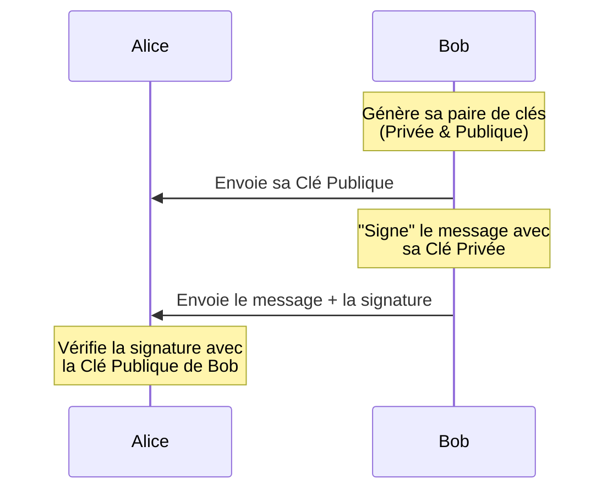

_Objectif : "Je veux que tout le monde sache que c'est bien moi qui ai envoyé ce message."_

- - - 

On parle également de **Signature numérique (authenticité)**

Ici, on utilise la **[[Clé Privée ]]de l'expéditeur** (Bob).

**Ce qu'il faut retenir :** Si Bob veut signer un document, il utilise sa [[clé privée]] pour créer une *"empreinte"* unique. N'importe qui possédant sa [[clé publique]] peut vérifier que cette empreinte correspond bien à son message. Si le message change d'un seul bit, la vérification échoue.