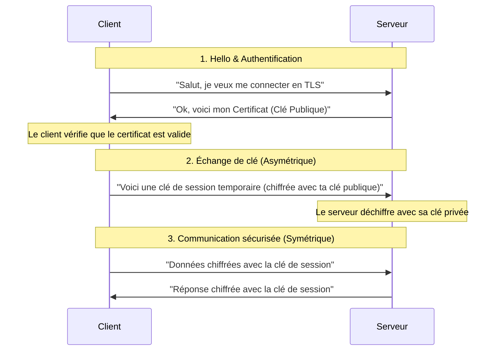

_Transport Layer Security_ (anciennement: *[[SSL]]*)

## 📌 Définition simple

TLS est le protocole qui sécurise les communications sur Internet. C'est le **"S"** de **HTTPS**. Il permet de transformer une connexion "en clair" (lisible par n'importe qui sur le réseau) en une connexion sécurisée.

## 🎯 Les 3 objectifs fondamentaux

Pour qu'une communication soit considérée comme "sécurisée" par TLS, elle doit remplir trois conditions :

1. **Confidentialité (Encryption) :** Personne ne peut lire les données sauf l'expéditeur et le destinataire.
2. **Intégrité :** Si quelqu'un modifie les données pendant le transport, le destinataire s'en rend compte immédiatement.
3. **Authentification :** Tu es certain que tu parles bien au bon serveur (ex: le vrai site de ta banque et non un pirate).

## 💡 Le concept clé : L'approche Hybride

TLS utilise **deux types de cryptographie** pour être à la fois rapide et sûr.

### 1. La [[Cryptographie Asymétrique]] (Lente mais sûre)

- **Usage :** Utilisée uniquement au **début** de la connexion (le "Handshake").
- **Rôle :** Permet de s'échanger une "clé de session" de manière sécurisée sans que personne ne puisse l'intercepter.
- **Analogie :** Envoyer un cadenas ouvert par la poste pour que l'autre puisse le fermer.

### 2. La [[Cryptographie Symétrique]] (Rapide mais risquée)

- **Usage :** Utilisée pour le **reste** de la conversation.
- **Rôle :** Une fois que les deux machines ont convenu d'une clé secrète, elles s'en servent pour chiffrer toutes les données.
- **Analogie :** Une fois que les deux ont le même cadenas, ils l'utilisent pour verrouiller toutes leurs boîtes.

> **Pourquoi ce mélange ?** Parce que la cryptographie asymétrique est beaucoup trop gourmande en CPU pour chiffrer des vidéos ou des gros fichiers. On l'utilise donc juste pour "convenir d'un secret", puis on passe au mode rapide.

## 🔄 Schéma simplifié du flux TLS

Voici comment cela se passe en 4 étapes globales :

> Une alternative encore plus sécurisé repose sur une authentification **mutuelle** du **client** et du **serveur**. C'est ce que l'on appelle le [[mTLS]]

## 🌐 Sources

https://www.cloudflare.com/learning/ssl/what-is-tls/
https://developer.mozilla.org/en-US/docs/Glossary/TLS
