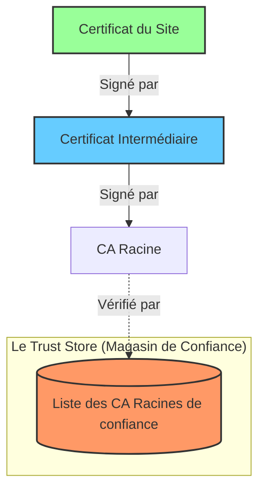

_Trust Store (Magasin de Confiance)_

---
## 📌 Définition simple

Le **Trust Store** est une base de données (une "liste blanche") contenue dans ton système d'exploitation (Windows, Linux, ...) ou dans ton navigateur. Elle contient les **[[Clé Publique|clés publiques]] des Autorités de Certification ([[CA]]) racines** en lesquelles le système a décidé de faire confiance par défaut.

_C'est le "carnet d'adresses" des "notaires" officiels._

## 🛂 L'analogie du "Club Privé"

Imagine un club très sélect. Pour entrer, tu dois présenter une carte d'identité.
1.  Le gardien du club a une **liste de notaires officiels** (le Trust Store).
2.  Si tu présentes une carte d'identité tamponnée par un notaire qui est sur sa liste $\rightarrow$ Tu peux entrer.
3.  Si tu présentes une carte d'identité tamponnée par un notaire qu'il ne connaît pas $\rightarrow$ Il te refuse l'entrée (Alerte rouge).

**Le point clé :** Le gardien n'a pas besoin de connaître chaque citoyen du monde (chaque site web), il a seulement besoin de connaître les notaires de confiance.

## ⛓️ Comment le Trust Store valide une chaîne ?

C'est ici que la "Chaîne de Confiance" que nous avons vue précédemment prend tout son sens. Quand tu visites un site, ton navigateur fait un voyage à rebours :

1.  **Certificat du Site :** "Je suis `google.com`, voici mon certificat signé par *CA Intermédiaire A*."
2.  **Certificat Intermédiaire :** "Je suis *CA Intermédiaire A*, voici mon certificat signé par *CA Racine B*."
3.  **CA Racine B :** "Je suis *CA Racine B*."
4.  **Vérification finale :** Le navigateur regarde dans son **Trust Store** : *"Est-ce que la Clé Publique de CA Racine B est dans ma liste ?"*
    *   Si **OUI** $\rightarrow$ La chaîne est complète et valide. Le cadenas devient vert.
    *   Si **NON** $\rightarrow$ La chaîne est rompue. Le navigateur affiche une alerte.

### Schéma de la vérification (Remontée de confiance)

## 💻 Détails techniques pour le développeur

En tant qu'utilisateur d'Ubuntu, il est utile de savoir que :

*   **Trust Store du Système :** Il se trouve généralement dans `/etc/ssl/certs`. C'est ce que les outils comme `curl`, `wget` ou tes applications Python/Node.js utilisent par défaut.
*   **Trust Store du Navigateur :** Certains navigateurs (comme Firefox) ont leur propre magasin de confiance indépendant du système pour plus de sécurité ou de flexibilité.
*   **Ajouter une CA personnalisée :** Si tu travailles en entreprise ou sur un labo privé, on te demandera souvent d'importer un certificat dans le Trust Store. Cela permet de rendre "officiels" des certificats auto-signés ou privés pour que tes outils de dev ne bloquent plus les connexions.

## 📝 Résumé
*   **Trust Store** = La liste blanche des "Notaires" (CA Racines) de confiance.
*   **Rôle** = Permettre au système de valider une chaîne de certificats jusqu'à une racine connue.
*   **Confiance** = Si la racine est dans le Trust Store, tout ce qu'elle a signé (directement ou indirectement) est considéré comme sûr.
*   **Différence avec le Certificat** : Le certificat est le document du site ; le Trust Store est la base de données de confiance du système.

