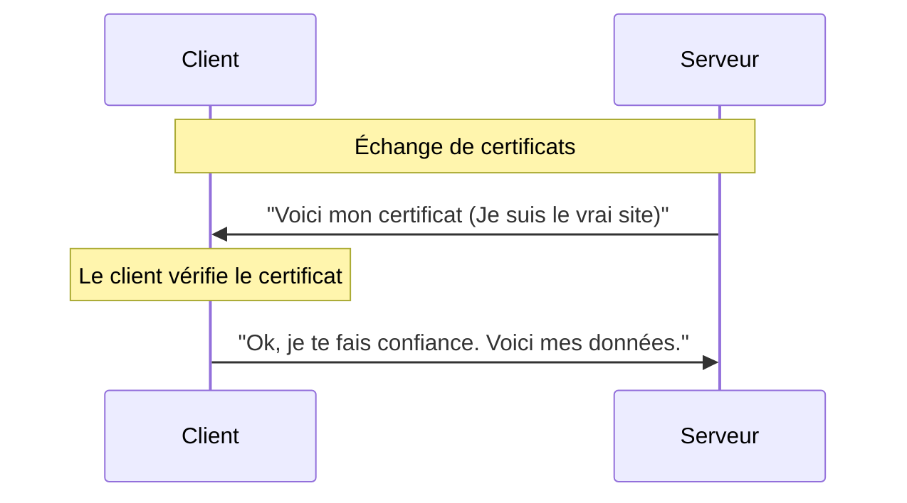
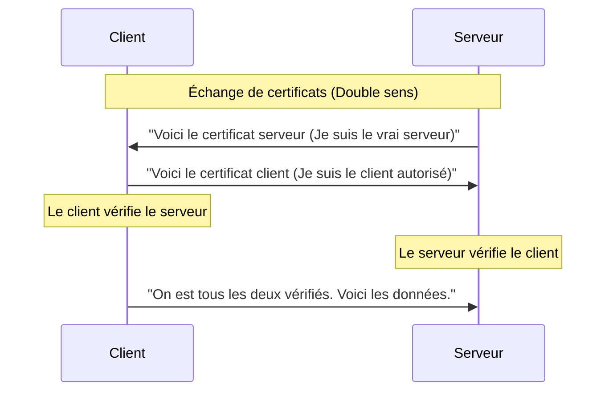

_mutual [[TLS]]_

---

## 📌 Définition simple

Le **mTLS** (ou TLS Mutuel) est une extension du protocole [[TLS]] standard. 
*   Dans le **[[TLS]] classique** (HTTPS), seul le **serveur** doit prouver son identité au client.
*   Dans le **mTLS**, le **client** doit AUSSI prouver son identité au serveur.

C'est une authentification à **double sens** : les deux parties doivent présenter un [[certificat]] valide avant de pouvoir communiquer.

## 🎭 L'analogie du bâtiment sécurisé

*   **TLS Standard (Entrer dans un magasin) :** Tu entres dans un magasin. Le magasin doit prouver qu'il est bien le magasin officiel (en affichant sa licence). Toi, tu n'as pas besoin de montrer ta carte d'identité pour entrer, tant que la porte est ouverte au public.
*   **mTLS (Entrer dans une salle de haute sécurité) :** Tu arrives devant une porte blindée. Le bâtiment doit prouver son identité, **ET** tu dois sortir ta carte d'identité pour prouver que tu es autorisé à entrer. Si l'un des deux n'a pas le bon badge, la porte reste fermée.

## 🔄 Schéma de comparaison (Diagramme de séquence)

### 1. [[TLS]] Classique (Le standard Web)

Le client vérifie qui est le serveur.

### 2. mTLS (L'authentification mutuelle)

Le client vérifie le serveur, ET le serveur vérifie le client.

## 🛠 Quand utilise-t-on le mTLS ? 

En tant que développeur, tu rencontreras le mTLS principalement dans des architectures où la sécurité est critique et où les acteurs sont connus à l'avance :

1.  **Microservices (Communication Inter-services) :** Pour s'assurer que seul le "Service A" a le droit de parler au "Service B".
2.  **API B2B :** Quand une entreprise veut donner accès à ses données à une autre entreprise spécifique (on ne veut pas que n'importe quel client puisse appeler l'API).
3.  **Architecture Zero Trust :** Un modèle de sécurité où "personne ne fait confiance à personne" par défaut, même à l'intérieur du réseau de l'entreprise.

## 📝 Résumé 

*   **TLS** = "Je veux être sûr que je parle au bon serveur."
*   **mTLS** = "Je veux être sûr que je parle au bon serveur, ET que le serveur est sûr que c'est bien moi."
*   **Avantage :** Sécurité maximale. Même si un pirate vole ton adresse IP ou ton nom d'utilisateur, il ne peut pas se connecter sans le certificat physique (la clé privée) du client.

C'est une nuance essentielle car, techniquement, **le fichier est le même** (un certificat numérique), mais son **usage**, sa **visibilité** et sa **destination** changent complètement.

---

# 🆔 Certificat Serveur vs Certificat Client

La différence entre un certificat serveur et un certificat client ne réside pas dans la technologie utilisée, mais dans **le rôle qu'il joue** au sein de la conversation [[TLS]].

*   **[[Certificat]] Serveur :** Prouve l'identité du **service** (le site, l'API).
*   **[[Certificat]] Client :** Prouve l'identité de **l'utilisateur** ou de la **machine** qui se connecte.

## 🔍 Détails des différences

### 1. Le [[Certificat]] Serveur 

C'est le certificat que tu vois sur tous les sites [[HTTPS]].
*   **Qui le possède ?** Le serveur web (ex: Nginx, Apache, un pod Kubernetes).
*   **Qui le voit ?** Tout le monde. N'importe qui peut demander à voir le certificat d'un site.
*   **But :** Garantir au client : *"Je suis bien le vrai site `google.com` (ou `api.ma-banque.com`). Tu peux m'envoyer tes données sans crainte."*
*   **Analogie :** L'enseigne lumineuse et la licence commerciale d'un magasin. Tout le monde peut les voir depuis la rue.

### 2. Le [[Certificat]] Client (Le standard "mTLS")

C'est le certificat utilisé dans les architectures sécurisées (mTLS, infrastructures d'entreprise).
*   **Qui le possède ?** Le client (ton navigateur, ton application mobile, ou un microservice).
*   **Qui le voit ?** Uniquement le serveur avec lequel il communique.
*   **But :** Garantir au serveur : *"Je suis bien l'utilisateur (ou la machine) autorisé que tu attends. Voici ma preuve d'identité."*
*   **Analogie :** Un badge VIP ou une carte d'identité professionnelle. Tu ne le montres qu'à la personne qui a le droit de le vérifier pour te laisser entrer.

## 💡 Note pour le développeur 

Pour ne pas te mélanger les pinceaux lors de la configuration :
*   **Certificat Serveur** $\rightarrow$ Va dans le **[[Key Store ]]du Serveur**.
*   **Certificat Client** $\rightarrow$ Va dans le **[[Key Store]] du Client**.
*   **[[Trust Store]]** $\rightarrow$ Contient toujours les **[[CA]]** (les notaires) qui ont signé les deux types de certificats.

